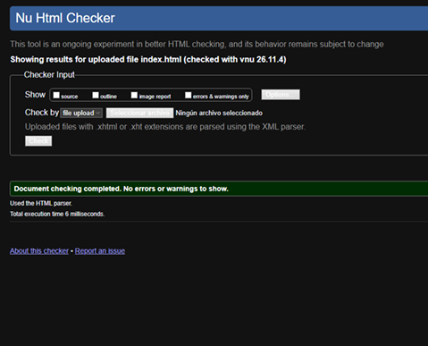
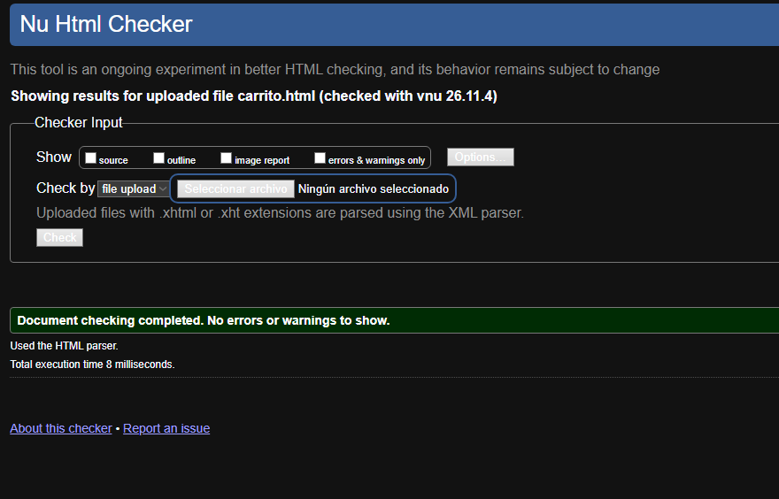
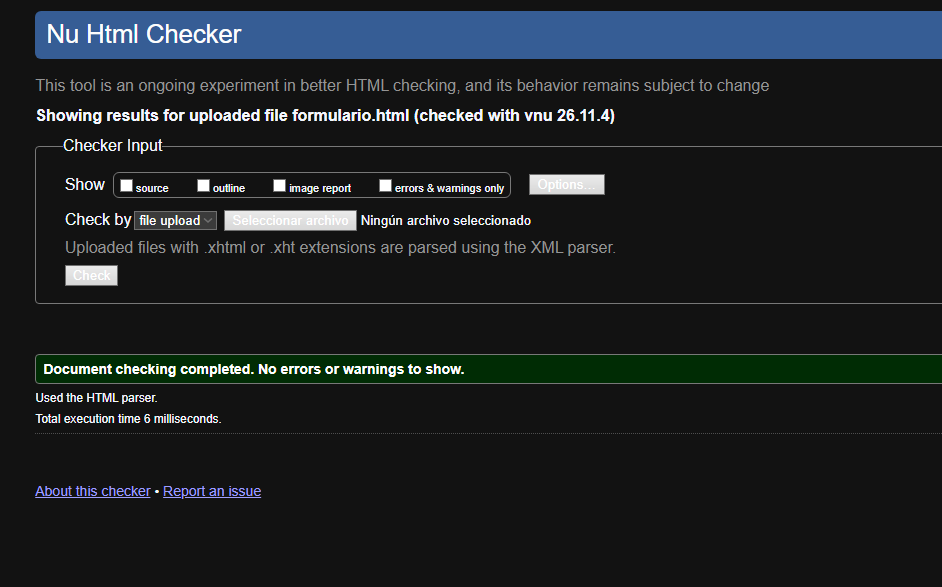
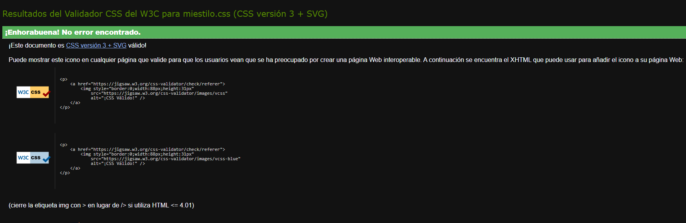

# AmiSiSi - Maquetación Front-End 

Este repositorio contiene la maquetación front-end del e-commerce **AmiSiSi**, basada en los diseños interactivos creados previamente en Figma. El proyecto cumple con los estándares de diseño responsive, accesibilidad semántica e incluye un sistema de tematización (Modo Claro / Modo Oscuro).

##  Tecnologías Utilizadas
* **HTML5:** Estructura semántica validada y accesible (incluyendo roles ARIA).
* **SCSS / CSS3:** Arquitectura modular, uso de variables y anidamiento para personalizar la UI.
* **Bootstrap 5:** Framework base utilizado para el sistema de rejilla (Grid de 12 columnas) y componentes responsivos, con variables sobreescritas desde SCSS para aplicar la identidad corporativa.
* **JavaScript:** Lógica de manipulación del DOM para alternar el Modo Oscuro.

##  Estructura del Proyecto
El repositorio sigue la estructura requerida:
* `index.html`, `carrito.html`, `formulario.html`: Archivos principales con la estructura semántica.
* `/scss/`: Directorio que contiene la arquitectura modular de Sass y las variables de diseño.
* `/css/`: Directorio que contiene el archivo `custom.css` final compilado y minificado.
* `/js/`: Scripts funcionales básicos.
* `/img/`: Assets gráficos e imágenes del proyecto.

##  Instrucciones para Compilar Sass
El proyecto está configurado para compilarse fácilmente. Si otro desarrollador necesita hacer cambios en los estilos, debe seguir estos pasos:

1. Abrir el proyecto en **Visual Studio Code**.
2. Instalar la extensión **Live Sass Compiler** (de Glenn Marks).
3. Abrir la carpeta `/scss` y realizar los cambios necesarios en el archivo `custom.scss` o sus parciales.
4. Hacer clic en el botón **"Watch Sass"** situado en la barra de estado inferior de VS Code.
5. La extensión compilará automáticamente el código y actualizará el archivo final en `/css/custom.css`.

##  Tematización (Modo Oscuro)
La interfaz soporta un cambio de tema dinámico. A través de un script JS enlazado al botón de la barra de navegación, se alterna el atributo `data-bs-theme="dark/light"` en la etiqueta HTML. Los estilos de Sass están configurados para responder a este atributo y cambiar de forma fluida el color de fondo, tipografías y contenedores translúcidos (efecto glassmorphism).

##  Validación W3C
El código fuente ha sido refactorizado y validado mediante las herramientas oficiales del W3C, garantizando la ausencia de errores estructurales y de jerarquía.

### Validación HTML
Se han validado independientemente las tres vistas principales del proyecto, obteniendo 0 errores en todas ellas:

**1. Página de Inicio (index.html)**

**2. Página del Carrito (carrito.html)**

**3. Página de Usuario (formulario.html)**

### Validación CSS
La hoja de estilos compilada final también ha sido validada sin errores:

